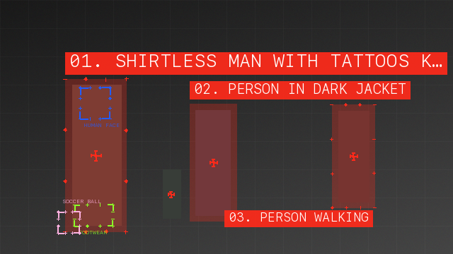
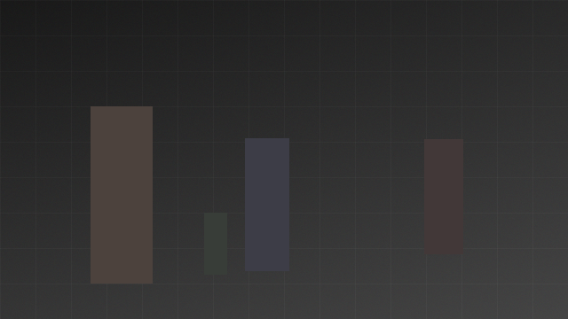
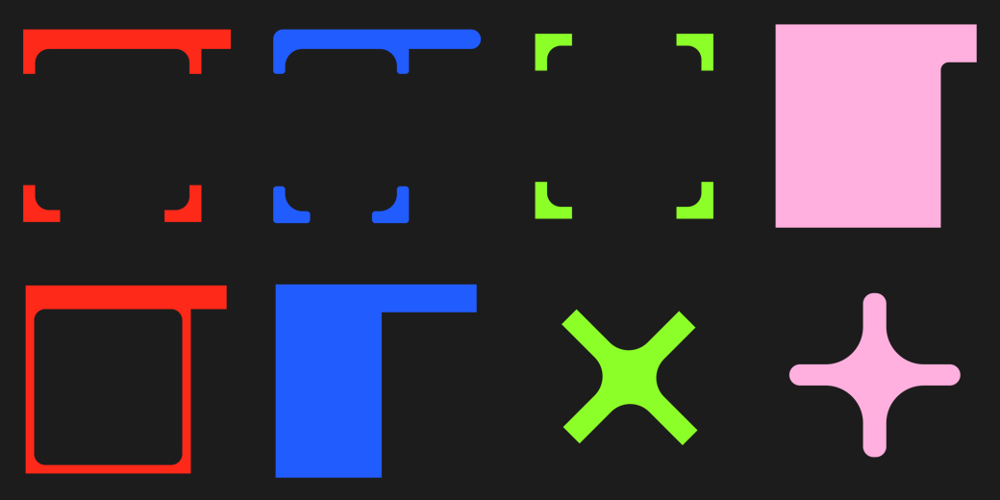
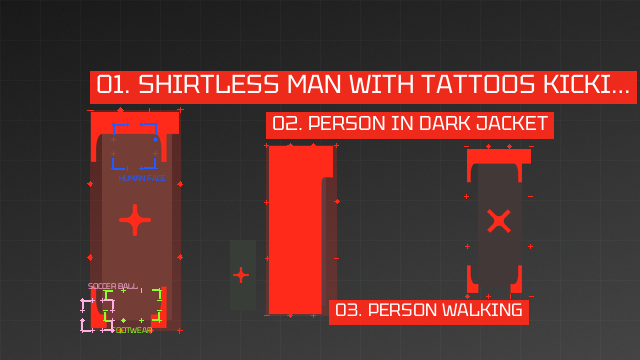

# ComfyUI-HUDKit

Designed, densely-labelled **HUD video overlays** driven by **native SAM3 tracking**.
Track people/objects with SAM3, attach stable short/detailed semantic labels, drop
your own transparent PNG frame & target graphics around each subject, and render a
finished sci-fi/editorial HUD video — **without any third-party bbox bridge nodes**.



*Synthetic sample (no model needed): primary `PERSON` labels, a blue `HUMAN FACE`
child bracket, `FOOTWEAR` / `SOCCER BALL` micro-tags, corner brackets, crosshairs,
registration marks, category colors, collision-aware label placement.*

---

## 1. What it does

This pack is a **server-side compositor**. Detection/segmentation/tracking is done by
ComfyUI's **native SAM3** nodes; this pack:

1. reads SAM3 output safely (preferred **`SAM3_TRACK_DATA`**, fallback **`BOUNDING_BOX`** + **`MASK`**),
2. keeps a **stable identity** per subject across frames (native object index, or an internal IoU tracker),
3. attaches **semantic annotations** (short/medium/detailed labels, actions, child regions) from **`YEA_ANNOTATIONS`** / JSON — *never invented from the mask*,
4. recolors your **white transparent PNG** frame/target assets to the track's palette color,
5. draws procedural HUD (corner brackets, outlines, translucent blocks, crosshairs, caption strips, registration marks),
6. places dense labels with **collision avoidance + temporal stability**,
7. returns an `IMAGE` batch for **Create Video / Save Video** (audio + fps preserved).

Three independent layers: **Tracking (SAM3) → Annotation (labels) → Rendering**.

## 2. Before / after

| Input frame | HUD applied |
|---|---|
|  |  |

Regenerate locally: `python examples/make_sample.py` → `examples/sample_output.mp4`.

### With your own HUD assets (the reference look)

Drop white-on-transparent PNGs into the renderer's slots — they get recolored per
track and fitted to each box. The bundled set (`examples/assets/`, 3334×3334 each)
maps to the inputs: **`Frame 1..6` → `frame_1..6_image`**, **`TARGET POINT 1..2` → `target_1..2_image`** (connect each Load Image's `MASK` too).

| Your designs (recolored) | Applied (Tektur + category colors) |
|---|---|
|  |  |

Reproduce: `python examples/make_sample_custom.py`. Tip: opaque designs (solid block /
filled corner) read best at lower `frame_opacity` over real footage; bracket/outline
designs work at full opacity.

## 3. Requirements

- ComfyUI **≥ 0.20.1** (native SAM3 landed in 0.20.1; built/verified on **0.24.0**).
- Python ≥ 3.10, `torch` (from ComfyUI), `numpy`, `Pillow`. **No** OpenCV/SciPy/VLM required.
- The native SAM3 nodes + a SAM3 checkpoint for the live workflow (this pack does **not** download models).

## 4. Install — ComfyUI Manager / Registry

This project is available from GitHub. It is **not yet published to the Comfy
Registry or listed in ComfyUI-Manager**. Use the manual installation below.

> Comfy Cloud note: custom-node *upload* is disabled on Cloud; running there requires
> Comfy Org to add the pack to the pre-installed set. See `docs/cloud_compatibility.md`.

## 5. Install — manual

```bash
cd ComfyUI/custom_nodes
git clone https://github.com/yilmazermananit/ComfyUI-HUDKit.git
cd ComfyUI-HUDKit
# Use the Python interpreter from your ComfyUI environment (torch already installed).
python -m pip install -r requirements.txt
```
Restart ComfyUI. The nodes appear under **`HUDKit`** and **`HUDKit/Annotation`**.

## 6. SAM3 example workflows

Import any JSON from `examples/` (drag onto the canvas):

| File | Flow |
|---|---|
| `sam3_hud_video_workflow.json` | **Primary.** Load Video → Get Video Components → SAM3 Video Track → **HUDKit Renderer** → Create Video → Save Video |
| `sam3_hud_image_batch_workflow.json` | SAM3 Detect (bbox+mask) → renderer (per-frame, no persistent tracking) |
| `manual_annotation_workflow.json` | + **HUDKit Annotation JSON** for hand-written detailed labels |
| `vlm_annotation_workflow.json` | + **Track Crop Extractor** → your VLM → **Annotation Builder** (one label per track) |
| `dense_multi_category_workflow.json` | two SAM3 groups (e.g. `person` + `face`) merged into one dense HUD |

You only: pick a video, type a SAM3 prompt (e.g. `person`), pick PNG assets, press **Run**.
You never convert bbox types or add SEGS/Impact/KJNodes bridges.

## 7. Preparing PNG assets

- **Transparent background** (real alpha), **graphic in white** (it gets recolored to the track color via `out_rgb = palette_color × luminance`).
- Square canvas is fine — the renderer **trims** transparent margins then fits the art to each box (`asset_fit_mode`: `stretch` for frames, `contain` for targets).
- Export **PNG**, connect **both** the Load Image `IMAGE` and `MASK` outputs to the matching renderer inputs. ComfyUI's Load Image `MASK` is inverse alpha — the renderer recovers true alpha automatically.

## 8. Node reference (summary)

Full I/O in [`docs/node_reference.md`](docs/node_reference.md).

- **HUDKit Renderer** — `frames` + (`track_data` | `bboxes` | `masks`) + optional `annotations` + 6 frame / 2 target PNG pairs → `images`, `debug_preview`, `tracking_json`.
- **HUDKit Inspect SAM3 Track Data** / **HUDKit Inspect Bounding Boxes** — print the real runtime structure; pass through unchanged.
- **HUDKit Mask to Native BBoxes** — MASK → native `BOUNDING_BOX` (connected components; no third-party type).
- **HUDKit Annotation JSON** / **Annotation Builder** / **Track Crop Extractor** / **Detailed Label Prompt** — the model-independent annotation layer (§10).

## 9. Default settings

```
seed 77 · style_mode mixed · max_objects 24 · display_probability 0.85
padding 8/8 · smoothing 0.55 · track_iou_threshold 0.25 · track_memory_frames 6
frame_opacity 1.0 · fill_opacity 0.30 · label_opacity 0.92 · line_width 3
target_scale 0.18 · flicker 0.04 · small_object_mode target_only · trim_assets true
caption_mode auto · label_length_mode adaptive · label_collision_mode reposition_and_shorten
```

## 10. Detailed labels (annotation layer)

The renderer **never invents** descriptions. Rich text comes from `YEA_ANNOTATIONS`:

- **Manual:** paste JSON into **HUDKit Annotation JSON** (see schema in `docs/node_reference.md`).
- **VLM:** **Track Crop Extractor** picks a few representative crops per track → your VLM (via **Detailed Label Prompt**'s strict JSON prompt) → **Annotation Builder** reduces multiple crop responses to one consensus label per track and caches it.

By-track caption JSON example:
```json
{ "person:0": "SHIRTLESS MAN WITH TATTOOS KICKING SOCCER BALL", "person:1": "PERSON IN DARK JACKET" }
```
Full annotation schema (tracks + children + frame_annotations) is documented in
`docs/node_reference.md`. Sensitive attributes (identity / ethnicity / religion /
nationality / medical) are **filtered out** even if a VLM returns them.

## 11. Troubleshooting

See [`docs/troubleshooting.md`](docs/troubleshooting.md). Quick hits:
- *"requires BOUNDING_BOX / MASK / TRACK_DATA"* → connect SAM3 Video Track (`track_data`) or SAM3 Detect.
- *Labels look wrong / socket won't connect* → run the **Inspect** nodes to see the real structure.
- *White PNG shows as a black box* → connect the Load Image **MASK** output too (inverse-alpha recovery).

## 12. BBox type compatibility

This pack consumes **only** native ComfyUI types: `SAM3_TRACK_DATA`, `BOUNDING_BOX`
(the `list[list[{x,y,width,height}]]` SAM3/mediapipe emit), `MASK`. It does **not**
use `BBOX` / `BBOX_LIST` / `SEGS` / `F_BBOXES` / Impact / KJNodes formats. If your
detector emits a custom type, convert with its own "to BOUNDING_BOX" node or feed a
MASK into **HUDKit Mask to Native BBoxes**. Don't trust socket color — verify types
with the Inspect nodes.

## 13. Performance

- Caption your VLM **once per track** (Track Crop Extractor), not per frame.
- Caches: fonts, recolored assets, resized assets (8px buckets), per-frame plans.
- One CPU/PIL round-trip per frame; progress bar + interruption supported.
- Tested dense: 50 annotations on 720p renders without error (see `docs/test_report.md`).

## 14. License

MIT — see [`LICENSE`](LICENSE). Copyright © 2026 DifferentGuys Studio.
The bundled Tektur font is distributed under its own [SIL Open Font License](yea_hud/fonts/Tektur-OFL.txt).
Built against native ComfyUI SAM3 (PR #13408). Not affiliated with Comfy Org or Meta.


## Development and compatibility

ComfyUI-HUDKit was previously named ComfyUI-YEAHUD. Display names and menu categories
now use **HUDKit**. Existing `YEA…` node IDs, socket type names, and the `yea_hud`
Python package are retained so saved workflows continue to load. Install only one
copy of the pack; rename an existing `ComfyUI-YEAHUD` installation folder to
`ComfyUI-HUDKit` rather than installing both.

To run the synthetic suite, use a Python environment with `torch` installed:

```bash
python -m pip install -r requirements.txt pytest
python -m pytest tests -q
```

The tests do not download checkpoints or call external services. The historical
live SAM3 test report is dated June 2026; live GPU/model inference is separate
from these synthetic checks. See [CONTRIBUTING.md](CONTRIBUTING.md) to report bugs
or contribute improvements.
